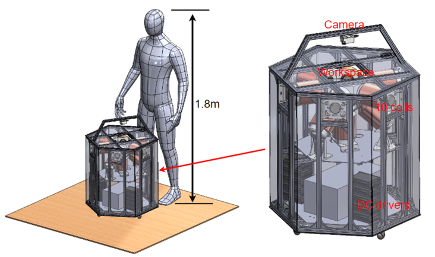
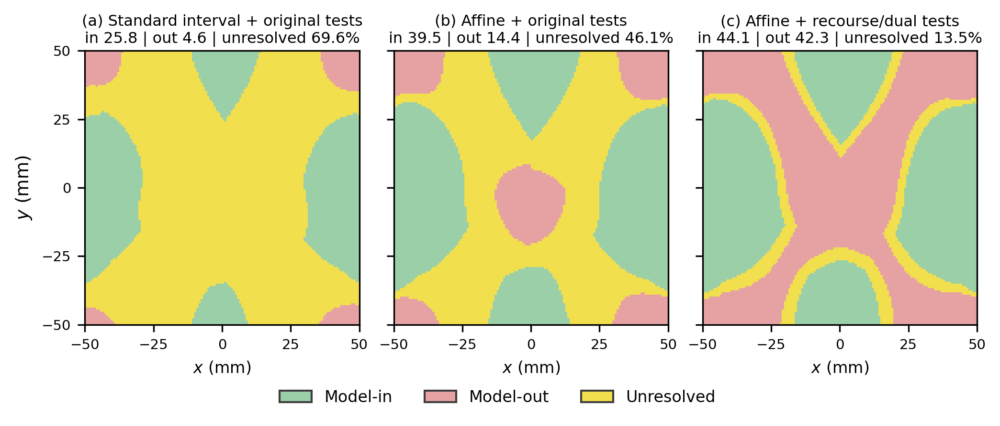
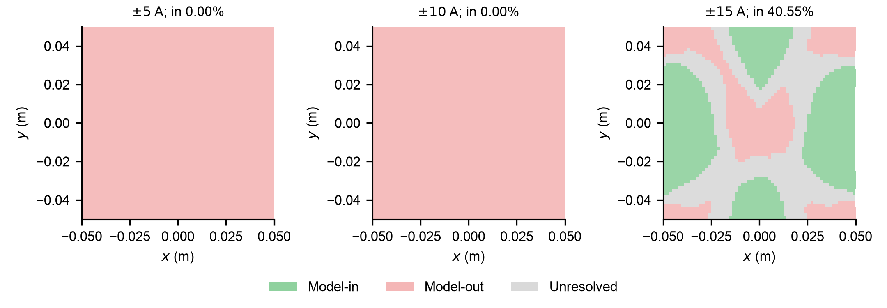

# Workspace for Multi-target Electromagnetic Control

Research code and reproduction inputs for **Electromagnetic control of multiple microrobots within certified feasible workspaces** by Da Zhao, Jiewen Tan, Xin Tong, Hongzhe Sun, Qi Luo, and Shing Shin Cheng.

The code models a shared ten-coil system under bounded currents. The actuation-feasible workspace (AFW) describes the outputs the coils can produce at a configuration. The task-feasible workspace (TFW) contains the configurations where the coils can produce every required command. Magnetic interactions enter the actuation map as configuration-dependent offsets.




## Task-feasible workspace results

The ten-coil benchmark maps a 100 × 100 mm plane. The field task requires every combination of `Bx` in ±120 mT and `By` in ±40 mT.

### Classifier comparison at 1 mm

With the per-coil current limit set to ±15 A, the affine recourse and dual tests reduced the unresolved area from **69.57% to 13.54%** compared with the interval baseline. They classified **44.13%** of the search area as inside the TFW and **42.33%** as outside. [Benchmark data](revision_analysis/tight_region_benchmark_1mm.json)



### Effect of the coil current limit

At 2 mm, the classifier placed the entire search area outside the TFW at ±5 A and ±10 A per coil. At ±15 A, it placed **40.55%** of the area inside. [Current-limit study data](sections_6_7_results/data/study_7_3_summary.json)



## Setup

Use Python 3.12 and run the commands from the repository root.

```sh
python3.12 -m venv .venv
source .venv/bin/activate
python -m pip install -r requirements.txt
python -m hybrid_region.test_hybrid_region
python -m pytest -q
```

On Windows PowerShell, activate the environment with `.venv\Scripts\Activate.ps1`. Force-test reference quadrature uses a C compiler with the `cc` command. The tests and figure workflows run offline with the included inputs.

## Reproduce the revised paper

| Paper topic | Source and results |
| --- | --- |
| Pointwise AFW and TFW, interval and affine enclosures, and branch-and-prune with dependency-preserving current recourse and dual support tests | [Numerical library](emns/), [region classifier](hybrid_region/), [ten-coil benchmarks and exports](sections_6_7_results/) |
| Measured cylinder-force fits and matched configuration-box comparisons | [Force-test workflow](dipole_error_comparison/force_test/) |
| Case Study 1. Orientation, interaction-aware routes, and repeated-speed tracking for cylindrical magnets | [Case-study commands](revised_case_studies/#1-cylindrical-magnets), [workspace figure](revised_case_studies/results/cs1/publication/cs1_workspace.pdf), [autonomous trials](revised_case_studies/results/cs1/publication/cs1_hardware.pdf), [speed comparison](revised_case_studies/results/cs1/publication/cs1_speed.pdf) |
| Case Study 2. Coordinated passing of two magnetic spheres in nearby vessels | [Case-study commands](revised_case_studies/#2-magnetic-spheres-in-vessels), [hardware trials](revised_case_studies/results/cs2/hardware/cs2_hardware.pdf) |
| Case Study 3. Selective adjustment of two magnetic growing rods | [Case-study commands](revised_case_studies/#3-magnetic-growing-rods), [calibration and placement](revised_case_studies/results/cs3_growing_rods/publication/cs3_calibration_tfw.pdf), [phantom trial](revised_case_studies/results/cs3_growing_rods/publication/cs3_phantom_trial.pdf) |

A short benchmark check uses the saved ablation results to regenerate their summary. The full run commands and output locations are in the [benchmark guide](sections_6_7_results/).

```sh
python -m analysis.sections_67.run --studies 6.4
python -m analysis.sections_67.validate_exports
python -m analysis.sections_67.paper_tables
```

The classifier can return inside, outside, or unresolved. The floating-point implementation uses no directed rounding. The force reserve derived from measured residuals is empirical.

The original examples and their setup are in the [legacy guide](LEGACY.md).
